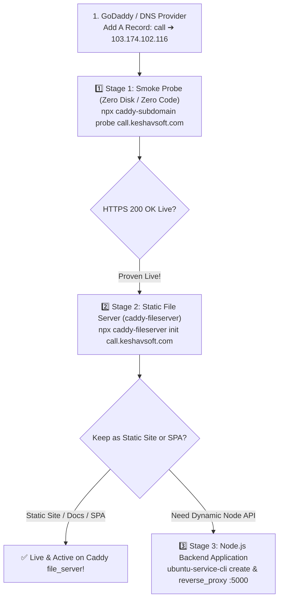

# caddy-fileserver

[](https://www.npmjs.com/package/caddy-fileserver)
[](LICENSE)
[](https://keshavsoft.github.io/caddy-fileserver/)
[](https://github.com/keshavsoft)
[](https://caddyserver.com/docs/)

> **The Bridge Between Caddy TLS (:443) and Ubuntu Filesystem (`/usr/share/...`).**  
> Automate Ubuntu document roots, starter templates, and Caddy `file_server` routes for zero-configuration static site hosting.

---

## 📑 Table of Contents

- [The Story: The Missing Half of Cloud Static Hosting](#-the-story-the-missing-half-of-cloud-static-hosting)
- [The 3-Stage VPS Subdomain Maturity Model](#-the-3-stage-vps-subdomain-maturity-model)
- [Interactive Documentation Portal](#-interactive-documentation-portal)
- [Quick Start with `npx`](#-quick-start-with-npx)
- [CLI Command Reference](#-cli-command-reference)
  - [`caddy-fileserver init`](#1-caddy-fileserver-init-domain-documentroot)
  - [`caddy-fileserver check`](#2-caddy-fileserver-check-domain-documentroot)
  - [`caddy-fileserver template`](#3-caddy-fileserver-template-domain-outputdir)
  - [`caddy-fileserver list`](#4-caddy-fileserver-list-configpath)
- [Programmatic ESM Library Reference](#-programmatic-esm-library-reference)
- [Ubuntu VPS Directory Conventions](#-ubuntu-vps-directory-conventions)

---

## 📖 The Story: The Missing Half of Cloud Static Hosting

When hosting subdomains on an Ubuntu VPS, static sites (HTML, React/Vue SPAs, documentation portals, asset CDNs) naturally span two sides:

```
[ Inbound HTTPS Requests :443 ]
               │
               ▼
┌──────────────────────────────┐
│     THE FRONT-DOOR GATEWAY   │  Managed by: caddy-fileserver & caddy-subdomain
│      Caddy Reverse Proxy     │  Config: /etc/caddy/caddy.json
│    (SSL Termination & TLS)   │  Handler: file_server
└──────────────┬───────────────┘
               │  Document Root: vars.root
               ▼
┌──────────────────────────────┐
│    THE UBUNTU FILESYSTEM     │  Managed by: caddy-fileserver
│   Physical Document Root     │  Location: /usr/share/<domain>
│   (index.html, assets, SPA)  │  Example: /usr/share/cli.keshavsoft.com
└──────────────────────────────┘
```

1. **The Gateway (`/etc/caddy/caddy.json`)**: Caddy receives public requests on `:443`, terminates Let's Encrypt certificates automatically, and dispatches requests to `file_server`.
2. **The Filesystem (`/usr/share/<domain>`)**: Where the actual files live on Ubuntu disk.

Without automation, developers must manually `mkdir -p /usr/share/<domain>`, create test HTML, manually edit Caddy's nested JSON AST, reload Caddy, and troubleshoot path typos.

**`caddy-fileserver` performs the entire 5-step lifecycle in one single atomic command.**

---

## 🧭 The 3-Stage VPS Subdomain Maturity Model

Eliminate 100% of the guesswork when provisioning new domains:



1. **Stage 1: Smoke Probe (`caddy-subdomain probe`)**: Verifies DNS and automatic HTTPS with in-memory `static_response: 200 OK`. Zero disk folders, zero Node.js processes.
2. **Stage 2: Static File Server (`caddy-fileserver init`)**: Provisions `/usr/share/<domain>`, drops a responsive starter `index.html`, and configures Caddy's native `file_server`. Verifies real disk I/O and static traffic.
3. **Stage 3: Full Dynamic Application (`ubuntu-service-cli`)**: When you need dynamic server-side rendering or APIs, bind a Node.js process to a port via systemd and promote the route to `reverse_proxy`.

---

## 🌐 Interactive Documentation Portal

- Live Documentation & Interactive Builder:  
  👉 **[https://keshavsoft.github.io/caddy-fileserver/](https://keshavsoft.github.io/caddy-fileserver/)**
- Dedicated NPX Command Catalog:  
  👉 **[https://keshavsoft.github.io/caddy-fileserver/npx/](https://keshavsoft.github.io/caddy-fileserver/npx/)**

---

## 🚀 Quick Start with `npx`

Zero installation required:

```bash
# Initialize folder, template index.html, Caddy route, reload & live probe
npx caddy-fileserver init call.keshavsoft.com

# Audit disk existence & Caddy route alignment
npx caddy-fileserver check call.keshavsoft.com

# List all active static file servers across the VPS
npx caddy-fileserver list
```

---

## ⚙️ CLI Command Reference

### 1. `caddy-fileserver init <domain> [documentRoot]`
Provisions document root on Ubuntu, drops starter template, configures Caddy JSON, and reloads:

```bash
# Standard Ubuntu path (/usr/share/call.keshavsoft.com)
npx caddy-fileserver init call.keshavsoft.com

# Custom document root path
npx caddy-fileserver init call.keshavsoft.com /var/www/call.keshavsoft.com

# Include XML sitemap
npx caddy-fileserver init call.keshavsoft.com --xml
```

**Terminal Output:**
```text
============================================================
✅ Static File Server Initialized Successfully!
============================================================
Subdomain:        call.keshavsoft.com
Document Root:    /usr/share/call.keshavsoft.com
Files Created:    index.html, sitemap.xml
Caddy Config:     /etc/caddy/caddy.json
Route Index:      2
Backup File:      /etc/caddy/caddy.json.bak.1795159230919
Caddy Reload:     Success
Live HTTPS:       Yes (200 OK - Verified)
============================================================
```

---

### 2. `caddy-fileserver check <domain> [documentRoot]`
Audits both sides to eliminate 404s and path mismatches:

```bash
npx caddy-fileserver check call.keshavsoft.com
```

**Terminal Output:**
```text
============================================================
Static File Server Audit: call.keshavsoft.com
============================================================

[Ubuntu Filesystem]
  Path:           /usr/share/call.keshavsoft.com
  Folder Exists:  ✅ Yes
  index.html:     ✅ Yes
  Total Files:    2

[Caddy Server Route]
  Config:         /etc/caddy/caddy.json
  Route Exists:   ✅ Yes
  Server / Index: srv0 / route[2]
  Handler Type:   ✅ file_server
  Target Root:    /usr/share/call.keshavsoft.com
  Root Match:     ✅ Aligned
============================================================
```

---

### 3. `caddy-fileserver template <domain> [outputDir]`
Generates standalone starter `index.html` and `sitemap.xml` without touching Caddy JSON:

```bash
npx caddy-fileserver template call.keshavsoft.com ./dist --xml
```

---

### 4. `caddy-fileserver list [configPath]`
Lists all `file_server` subdomains in Caddy JSON and cross-checks whether their disk directory exists:

```bash
npx caddy-fileserver list
```

---

## 📦 Programmatic ESM Library Reference

Use `caddy-fileserver` directly inside your Node.js automation and cloud provisioning scripts:

```javascript
import {
  initStaticSite,
  checkStaticSite,
  listStaticSites,
  buildStaticRoute,
  provisionDocumentRoot,
  generateStarterHtml,
  generateStarterXml
} from "caddy-fileserver";

// Initialize static site in 1 line
const site = await initStaticSite({
  domain: "call.keshavsoft.com",
  root: "/usr/share/call.keshavsoft.com",
  xml: true
});

console.log(`Live: ${site.domain} (root: ${site.rootPath})`);
```

---

## 🐧 Ubuntu VPS Directory Conventions

Following KeshavSoft production architecture:

| Component | Standard VPS Location | Purpose |
| :--- | :--- | :--- |
| **Caddy JSON** | `/etc/caddy/caddy.json` | Public reverse proxy and TLS gateway |
| **Static Document Roots** | `/usr/share/<domain>` | Static HTML, React/Vue SPAs, documentation |
| **Node.js Backends** | `/root/KeshavSoft/<app>` | Dynamic application working directories |
| **Systemd Services** | `/etc/systemd/system/<domain>.service` | Managed by `ubuntu-service-cli` |

---

## 🧩 The KeshavSoft Caddy Suite Ecosystem

| Repository | Responsibility | npm / Docs | Key Command |
| :--- | :--- | :--- | :--- |
| **[`caddy-cli`](https://github.com/keshavsoft/caddy-cli)** | Observability & Port Mapping | [](https://www.npmjs.com/package/caddy-cli) | `npx caddy-cli -p` |
| **[`caddy-template`](https://github.com/keshavsoft/caddy-template)** | Route Blueprint Generation | [](https://www.npmjs.com/package/caddy-template) | `npx caddy-template proxy <host> <port>` |
| **[`caddy-subdomain`](https://github.com/keshavsoft/caddy-subdomain)** | Smoke Probes & Promotion | [](https://www.npmjs.com/package/caddy-subdomain) | `npx caddy-subdomain probe <host>` |
| **[`caddy-fileserver`](https://github.com/keshavsoft/caddy-fileserver)** | Ubuntu Filesystem Bridge | [](https://www.npmjs.com/package/caddy-fileserver) | `npx caddy-fileserver init <host>` |
| **[`caddy-knowledge`](https://github.com/keshavsoft/caddy-knowledge)** | Master Architectural Handbook | [Live Handbook](https://keshavsoft.github.io/caddy-knowledge/) | Full Suite Reference |
| **[`caddy-template-knowledge`](https://github.com/keshavsoft/caddy-template-knowledge)** | Route Blueprint Manual | [Live Manual](https://keshavsoft.github.io/caddy-template-knowledge/) | AST Deep-Dives |
| **[`caddy-hosting`](https://github.com/keshavsoft/caddy-hosting)** | Unified Gateway & Hub | [Live Portal](https://keshavsoft.github.io/caddy-hosting/) | Gateway Hub |

---

## 📄 License

ISC &copy; KeshavSoft
